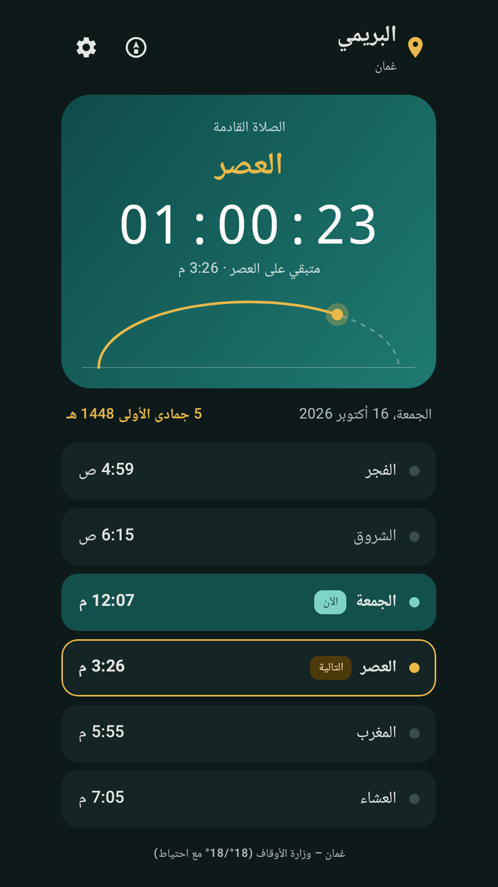
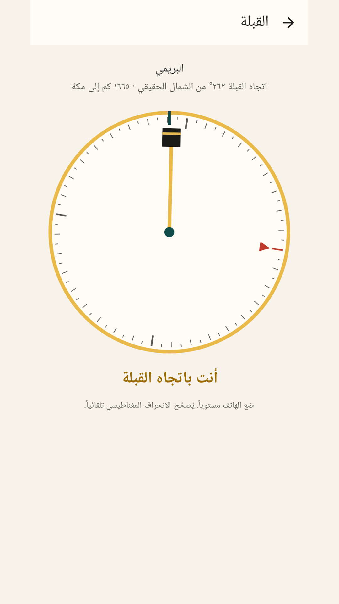
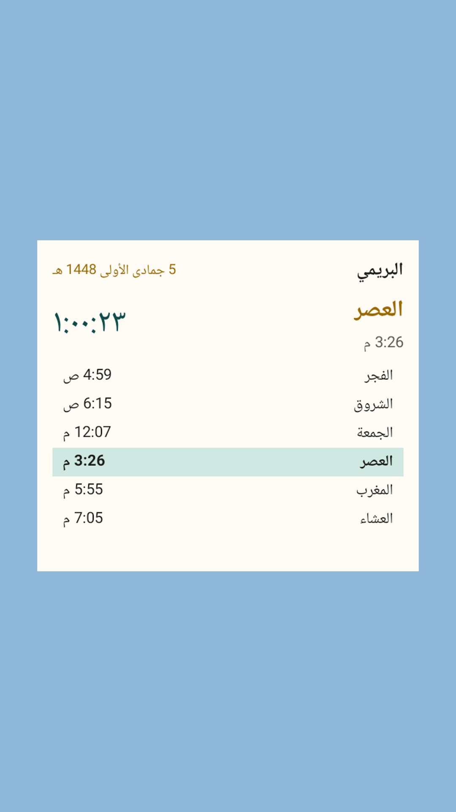
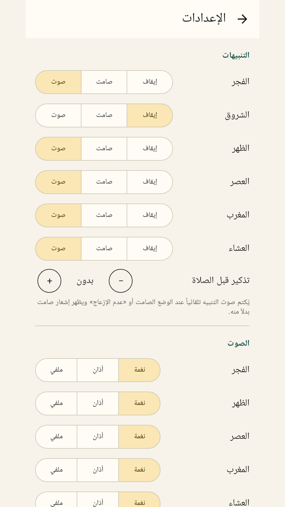

<div align="center">


# مواقيتي · Mi5G Prayer

**تطبيق مواقيت صلاة مع القبلة والأذكار والودجت والصامت التلقائي، يعمل بدون إنترنت، بلا إعلانات ولا تتبع. مع دقة خاصة لعُمان.**

[](https://github.com/al3nkboot/prayer-times/releases/latest)


[**⬇️ تحميل أحدث إصدار (APK)**](https://github.com/al3nkboot/prayer-times/releases/latest)

</div>

<p align="center">




</p>

<div dir="rtl">

## المميزات

- **طرق حساب متعددة:** أم القرى، رابطة العالم الإسلامي، الهيئة المصرية، أمريكا الشمالية (ISNA)، كراتشي، دبي، قطر، الكويت، وطريقة عُمان (الافتراضية)، مع اختيار المذهب في العصر وتعديل الدقائق لكل صلاة.
- **المدن والموقع:** قائمة مدن مدمجة تعمل بدون إنترنت لعُمان والخليج وعدد من العواصم العربية، أو تحديد موقعك تلقائيًا.
- **دقة خاصة لعُمان:** طريقة وزارة الأوقاف العُمانية مطابقة لتقويم الوزارة لعام 2026 بفارق لا يتجاوز دقيقة واحدة.
- **الأذان والتنبيهات:** أذان أو تنبيه أو صامت لكل صلاة، وتذكير قبل الأذان، وإمكانية اختيار صوت أذان من جهازك.
- **صامت تلقائي وقت الصلاة:** يحوّل الجوال إلى صامت أو اهتزاز لمدة تختارها، ثم يعيده إلى وضعه السابق.
- **أذكار الصباح والمساء:** من «حصن المسلم» مع عدّاد للتكرار وتذكير اختياري.
- **اتجاه القبلة:** بوصلة مع تصحيح الانحراف المغناطيسي.
- **ودجت للشاشة الرئيسية:** بثلاثة أحجام، مع عدّاد تنازلي للصلاة القادمة.
- **التاريخ الهجري** مع إمكانية تعديله.
- **عربي وإنجليزي** مع وضع فاتح وداكن.
- **ملاحظة حالية:** المنطقة الزمنية تؤخذ من أقرب مدينة في القائمة المدمجة (الخليج والعالم العربي)، لذلك قد تظهر الأوقات بتوقيت خاطئ خارج هذه المنطقة إلى أن تُضاف مدن أكثر.
- **خصوصية تامة:** لا يطلب إذن الإنترنت، وتُحسب الأوقات على جهازك.

## التثبيت

1. حمّل ملف APK من [صفحة الإصدارات](https://github.com/al3nkboot/prayer-times/releases/latest).
2. افتحه واسمح بالتثبيت من هذا المصدر.
3. فعّل «المنبّهات الدقيقة» من داخل التطبيق ليصل الأذان في وقته بالضبط.

التحديثات الجديدة تُثبَّت فوق الإصدار السابق دون فقدان إعداداتك.

</div>

---

## English

**Mi5G Prayer** is a fully offline prayer-times app with a Qibla compass, adhkar, a home-screen widget and auto-silent: no ads, no tracking, no internet permission.

- Calculation methods: Umm al-Qura, Muslim World League, Egyptian, ISNA, Karachi, Dubai, Qatar, Kuwait and Oman (default), with Shafi/Hanafi Asr and per-prayer minute offsets.
- Bundled offline city list for Oman, the Gulf and several Arab capitals, or automatic location.
- **Extra accuracy for Oman:** the Oman Ministry of Awqaf method matches the Ministry's 2026 calendar within ±1 minute ([accuracy](docs/accuracy.md)).
- **Current limitation:** the time zone is taken from the nearest bundled city (Gulf / Arab world), so outside that region times may show in the wrong time zone until more cities are added.
- Adhan, alerts and pre-prayer reminders per prayer; custom adhan sound.
- Auto-silent during prayer, restoring your previous ringer mode afterwards.
- Morning and evening adhkar from Hisn al-Muslim with counters and reminders.
- Qibla compass, Hijri date, and a responsive home-screen widget.
- Arabic (RTL) and English, light and dark themes.

**Download:** [latest release](https://github.com/al3nkboot/prayer-times/releases/latest) · Android 8.0+

### Build

```bash
./gradlew testDebugUnitTest assembleRelease   # JDK 17
```

Kotlin · Jetpack Compose · Material 3 · Glance · [adhan-java](https://github.com/batoulapps/adhan-java).
Signing keys are kept outside the repository. Developer notes: [docs/development-notes.md](docs/development-notes.md).

### Credits & privacy

Third-party sources and audio attribution: [CREDITS.md](CREDITS.md) · [Privacy policy](docs/privacy-policy.md)

Made by [@midroid5G](https://x.com/midroid5G).
